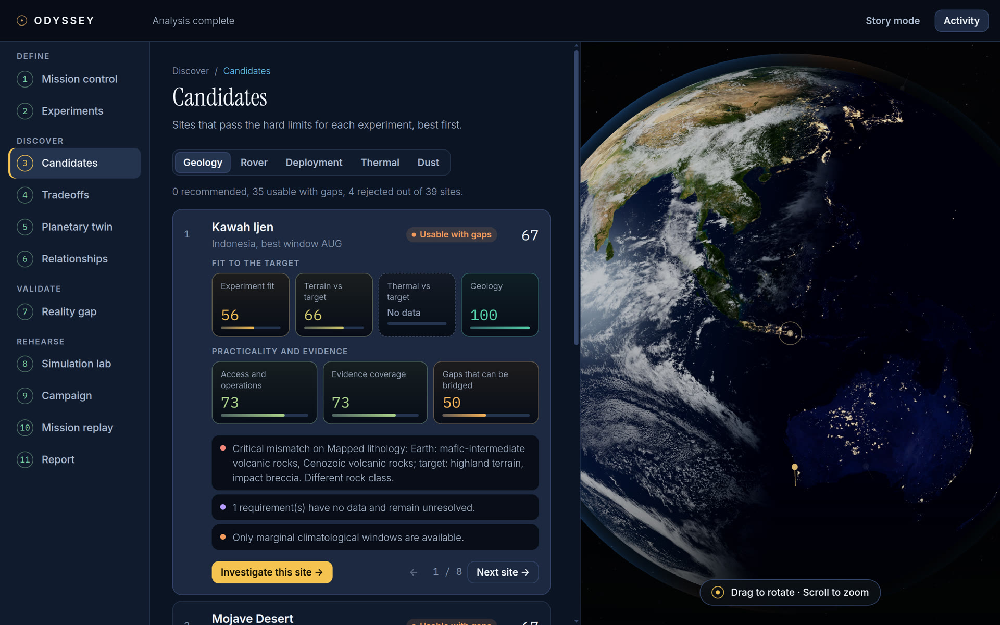
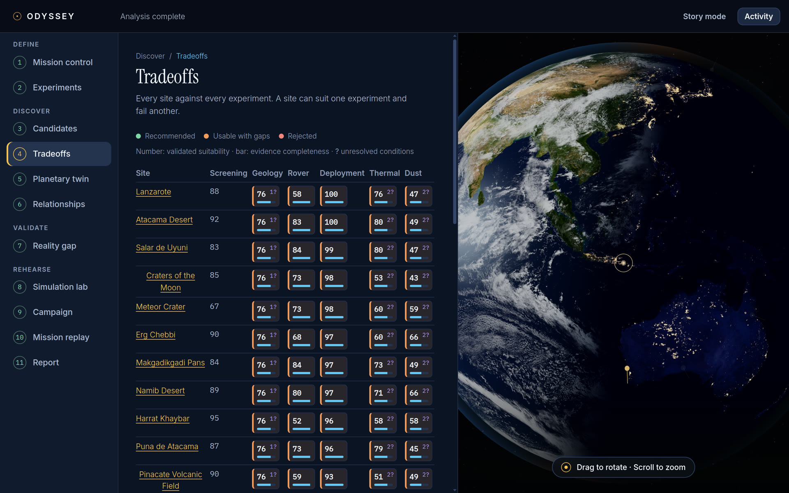
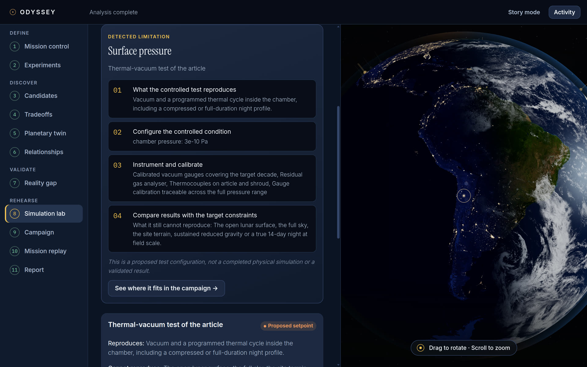

# ODYSSEY

**Plan Moon and Mars field tests on Earth, and see exactly where Earth falls short.**

ODYSSEY turns a mission brief ("a seven-day lunar expedition with geological sampling, rover navigation…") into experiments, finds the Earth sites that suit each one from open NASA and partner-agency data, compares every site with the lunar south pole or Mars (Jezero crater) condition by condition, and says what no site can reproduce and how to test it instead.

Built by team **ناسا سبيس ابس جدا** for the NASA Space Apps Challenge 2026, *Identify Earth Locations that Analog the Permanent Moon Base Locations and Mars*.

**Try it:** [live application](https://odyssey.qd.je) · [example analysis](https://odyssey.qd.je/?run=65a483d3-9cd9-4369-b094-4df64a0c179a) · [NASA Space Apps project page](https://www.spaceappschallenge.org/2026/find-a-team/ns-sbys-bs-jd/?tab=project) · [project description (PDF)](docs/submission/ODYSSEY_project_description.pdf)


## Why it is different

* **Experiment first, not planet first.** A site can be strong for rover navigation and weak for thermal testing. ODYSSEY ranks sites per experiment.
* **It explains where the analogy breaks.** Each experiment gets a condition-by-condition comparison with the target, and gravity, vacuum, the lunar night and radiation are flagged as *not reproducible anywhere on Earth*, with a controlled intervention proposed.
* **Missing evidence is never a match, and never a mismatch.** Every gap says why it exists: a dataset that is not yet connected, a quantity that needs a field measurement (and which test), or a condition Earth physically cannot provide.
* **A real tool-using agent** does the work, with every number computed by deterministic, unit-aware code and every claimed source checked verbatim.

## What it looks like

| While the agent works: the target and Earth are scanned together | Mission control: the brief as a plan |
|---|---|
|  |  |
| **Candidates per experiment, scores coloured by value** | **Why a site scores what it does** |
|  |  |
| **Challenge this match** | **Physics Earth cannot copy** |
|  |  |
| **Tradeoffs across experiments** | **Simulation lab** |
|  |  |

More: [planetary twin](docs/screenshots/v2-08-twin.jpg), [illumination](docs/screenshots/v2-11-illumination.jpg), [dust transport](docs/screenshots/v2-12-dust.jpg), [feature relationships](docs/screenshots/v2-13-relationships.jpg), [ranking evolution](docs/screenshots/v2-06-ranking.jpg), [reality gap](docs/screenshots/v2-14-reality-gap.jpg), [campaign](docs/screenshots/v2-17-campaign.jpg), [mission replay](docs/screenshots/v2-18-replay.jpg), [report](docs/screenshots/v2-19-report.jpg).

## The workspace

The sidebar follows the mission in four stages.

| Stage | Section | What it answers |
|---|---|---|
| Define | Mission control | Target, duration, experiments and requirements, with a photo per experiment |
| Define | Experiments | Each requirement with the evidence behind it |
| Discover | Candidates | Sites ranked per experiment; the best one opens automatically |
| Discover | Tradeoffs | Every site against every experiment, and how validation reorders the ranking |
| Discover | Planetary twin | Why the similarity score is what it is; Earth and target side by side; *Challenge this match*; the physics Earth cannot copy (gravity, pressure, illumination, dust) |
| Discover | Relationships | How measured Earth conditions move together across the analog sites |
| Validate | Reality gap | Conditions no site reproduces, and evidence that is missing and why |
| Rehearse | Simulation lab | Controlled tests for what Earth cannot provide, as numbered proposed steps |
| Rehearse | Campaign | A multi-site field plan, optimised three ways |
| Rehearse | Mission replay | The analysis from brief to residual gaps, as a timeline |
| Rehearse | Report | Narrative, findings and exports (Markdown, JSON) |

*Story mode* walks through the stages for a presentation.

## The demonstration

Brief: *"Plan a seven-day simulated lunar surface expedition that includes geological sampling, rover navigation, equipment deployment, thermal survival and dust mitigation."*

A saved run of this brief is in [`docs/demo/agent-run/`](docs/demo/agent-run/). It is **saved demonstration output** from 2026-11-14 (run `65a483d3`), not a live result. Highlights:

* Five experiments, 35 requirements, 39 curated Earth sites, compared with the lunar south pole.
* **Geological sampling:** no curated site matches the south-pole lithology (highland impact breccia, Spudis et al. 2008), so every site is downgraded. Four sites are ruled out because even their barest 2 × 2 km area has under 5% bare ground (ESA WorldCover). ODYSSEY points to Manicouagan and Pingualuit, where Macrostrat maps anorthosite, as better geology analogs.
* **Thermal survival:** no Earth site reaches the lunar 50–250 K surface range, and air carries heat away where the Moon has vacuum. The plan uses a thermal-vacuum chamber, with a first-order pump-down model.
* **Evidence gaps, each with a next step:** bearing strength (dynamic cone penetrometer, ASTM D6951), SI thermal inertia (needle probe, ASTM D5334), grain size (sieve analysis) and rock exposure need field measurements. Dust deposition and mineralogy need datasets that exist but are not connected (MERRA-2 and EMIT require an Earthdata login).
* **Campaign:** Atacama Desert for four experiments plus a dust site, with 9 open conditions listed.

Step-by-step walkthrough: [`docs/demo/README.md`](docs/demo/README.md).

## How it works

```
 Mission brief
      │
      ▼
┌────────────────────────────── Agent (server/agent) ──────────────────────────────┐
│ LLM chooses tools; the runtime enforces budgets, preconditions and completion.   │
│ parse_mission → decompose_experiments → rank_candidate_regions →                │
│ detect_environmental_mismatch → investigate_evidence_gap →                      │
│ find_intervention_options → optimize_campaign → generate_mission_report         │
└──────────────┬───────────────────────────────┬──────────────────────────────────┘
               │ deterministic engines          │ optional, bounded external calls
               ▼                                ▼
  src/mission    requirements + evaluation   Serper search*, source retrieval,
  src/mission/evidence.ts  evidence registry   verbatim claim verification,
  server/science profiles, comparisons,      literature reranking*
                 candidates, interventions
  src/temporal   climate windows
  src/campaign   multi-site optimiser
               │
               ▼
  src/data/*.json  committed datasets (NASA POWER, MODIS, LOLA, MOLA, Copernicus DEM,
                   Sentinel-2, WorldCover, Macrostrat, WorldClim, RADARSAT-1 …)
               │
               ▼
  React + Three.js workspace (src/workspace): 11 sections in four stages
  (Define, Discover, Validate, Rehearse), with a live agent trace
```
\* Optional components; see [Configuration](#configuration).

* **Science layer:** 31 environmental dimensions, each with an evidence class (MEASURED, DERIVED, MODELED, PUBLISHED, PROXY, ESTIMATED, MISSING) and an explicit spatial and temporal support. Two values are compared only when quantity and support match, so air temperature is never compared with surface temperature, and a 40 m slope never with a 400 m one. See [`docs/science/SCIENTIFIC_METHODOLOGY.md`](docs/science/SCIENTIFIC_METHODOLOGY.md).
* **Evidence registry:** every requirement maps to a physical quantity, unit, support, datasets (used, found but not connected, or rejected with reasons), method, limitation and next action. See [`docs/science/REQUIREMENT_EVIDENCE_REGISTRY.md`](docs/science/REQUIREMENT_EVIDENCE_REGISTRY.md).
* **Interventions:** where Earth cannot reproduce a condition, ODYSSEY proposes a controlled test (thermal-vacuum chamber, gravity offload, CO₂ chamber) with labelled first-order physics: SIMULATED, PROPOSED CONTROLLED CONDITION or CONCEPT ONLY. See [`docs/science/INTERVENTION_METHODOLOGY.md`](docs/science/INTERVENTION_METHODOLOGY.md).
* **Agent:** 19 tools. Search results stay *pending review* until a full source is retrieved and the quoted value is found in it. The model never computes numbers. See [`docs/architecture/AGENT_ARCHITECTURE.md`](docs/architecture/AGENT_ARCHITECTURE.md).
* **Global discovery:** an H3 screen of Earth's land surface, not seeded by known sites, produces 80 generated regions beyond 39 curated sites and 107 screened candidates. See [`docs/science/ANALOG_DISCOVERY_ENGINE.md`](docs/science/ANALOG_DISCOVERY_ENGINE.md).

## NASA and partner data

From the challenge's Resources tab, ODYSSEY uses the **NASA Planetary Data System / LRO**: the LOLA south-polar DEM `LDEM_45S_400M` from the PDS Geosciences Node is the lunar terrain reference. It also uses **LRO Diviner** results (polar temperature range, regolith thermal inertia) as published references, **NASA Worldview/GIBS** imagery, and the partner resources **ESA Copernicus** (DEM, Sentinel-2, WorldCover) and **CSA RADARSAT-1**.

Other NASA data: NASA POWER (MERRA-2), MODIS Aqua land-surface temperature (MYD11A1 v061), MGS MOLA, NSSDC fact sheets, Blue Marble and Black Marble. Full list with identifiers, units, resolution, limitations and terms: [`DATA_SOURCES.md`](DATA_SOURCES.md).

## Installation

Requirements: **Node.js ≥ 22.13** (tested on 26.0; `node:sqlite` is used), npm. Python ≥ 3.10 only for the optional components, ≥ 3.12 for the data pipelines.

```bash
git clone https://github.com/MahmoudAdelbghany/ODYSSEY.git odyssey && cd odyssey
npm ci                      # exact versions from package-lock.json
cp .env.example .env        # optional: add your own keys (see below)
```

No dataset download is needed: the derived data the app uses is committed in `src/data/` and `public/`. Scripts in `scripts/` regenerate it from the original sources (see each script's header).

## Configuration

Everything is read by the backend from `.env` (never exposed to the browser). All keys are optional.

| Without anything | With `OPENCODE_API_KEY` | With `SERPER_API_KEY` **and** the Earth-Location-Nasa component | With the Reranker component |
|---|---|---|---|
| Full app; the agent runs with the **deterministic planner** (same tools, fixed order, no LLM). All data, comparisons, interventions, campaign and report work. | The LLM agent chooses tools and writes the report narrative. Any OpenAI-compatible tool-calling model on OpenCode works (`OPENCODE_MODEL`). | Live evidence search on allow-listed scientific domains. | Literature-weighted reranking of viable candidates. |

The two optional Python components are **not included** in this repository (see [`THIRD_PARTY_NOTICES.md`](THIRD_PARTY_NOTICES.md)): `mernaahany/Earth-Location-Nasa` has no licence file, and `WA-on-test2/Reranker` is private. If you have access and permission, place them in `external/Earth-Location-Nasa` and `external/Reranker`. `GET /api/health` reports which components are installed.

## Running

```bash
npm run server        # API on http://127.0.0.1:8787
npm run dev           # UI on http://localhost:5173 (proxies /api)
```

Open http://localhost:5173, keep or edit the sample brief, and press **Analyze mission**.

Production: `npm run build && npm start`, then open http://127.0.0.1:8787.

Container: `docker build -t odyssey .` then `docker run -p 8787:8787 --env-file .env odyssey`. The public deployment (https://odyssey.qd.je) runs this image on Azure Container Apps.

Exports: the Report section downloads Markdown and JSON; the API serves `GET /api/runs/<id>/report.md` and `report.json`.

## Tests

```bash
npm run lint
npm run build                 # type-checks app and server, builds the UI
npm test                      # Node tests: 68 run in a clean clone; 3 more run when the optional components are installed
npm run test:python           # 48 pipeline tests (pip install -r scripts/requirements.txt first)
npm run secrets:scan          # working tree and built bundle
npm run secrets:history       # every blob in Git history
```

`npm run test:smoke` runs live LLM and search tests and needs keys.

## Limitations

* No environmental dimension is complete. Bearing strength, SI thermal inertia, grain size, mineralogy and fresh rock exposure are **not measured** at any site; ODYSSEY says so and names the field test.
* Climate values are 2001–2020 reanalysis normals at ~50 km, not station records. MODIS surface temperatures cover one warm-season window. Terrain is 40 m; rocks and rover-scale hazards are not resolved, and roughness thresholds of 2–2.5 m sit at the DEM's stated 2 m relative accuracy.
* 33 of 35 requirement thresholds in the demonstration are recipe assumptions without a cited source; the interface labels them as such.
* The field access and dust indices of the curated sites were assigned by hand and are labelled *unvalidated estimates*.
* Lunar references are regional or point values: thermal inertia is a global Diviner average, grain size comes from non-polar Apollo soils, darkness duration is for the best-lit Shackleton rim point.
* Intervention outputs are setpoints and first-order models, not facility performance. Costs are not estimated.
* Earth cannot provide lunar or Martian gravity, vacuum, radiation or atmosphere at any site.

Scientific audits: [`docs/science/`](docs/science/). Release status and open issues: [`RELEASE_READINESS_REPORT.md`](RELEASE_READINESS_REPORT.md).

## Repository layout

```
server/            Node backend: agent, science engines, evidence retrieval, API, tests
src/               React workspace, mission/temporal/campaign/intervention engines, data
public/            Textures, site imagery, heightmaps, fonts
scripts/           Data acquisition and derivation pipelines (Python), release tooling
docs/              architecture/, science/, screenshots/, demo/, submission/, history/
```

## Licence and attribution

ODYSSEY's original code and documentation: **Apache License 2.0** ([`LICENSE`](LICENSE), [`NOTICE`](NOTICE)). Third-party code, fonts, imagery and data keep their own licences: [`THIRD_PARTY_NOTICES.md`](THIRD_PARTY_NOTICES.md) and [`DATA_SOURCES.md`](DATA_SOURCES.md). Contains modified Copernicus Sentinel and Copernicus DEM data. NASA data are used under NASA's open data policy; this project is not endorsed by NASA.

## Team and acknowledgements

Team: **ناسا سبيس ابس جدا** ([NASA Space Apps project page](https://www.spaceappschallenge.org/2026/find-a-team/ns-sbys-bs-jd/?tab=project)).

Thanks to the authors of Earth-Location-Nasa (`mernaahany`) and the Reranker (`WA-on-test2`), and to the NASA, ESA, CSA, USGS, Macrostrat, WorldClim, Natural Earth and OurAirports teams whose open data make this possible. AI use is disclosed in [`docs/submission/NASA_SPACE_APPS_SUBMISSION.md`](docs/submission/NASA_SPACE_APPS_SUBMISSION.md).
