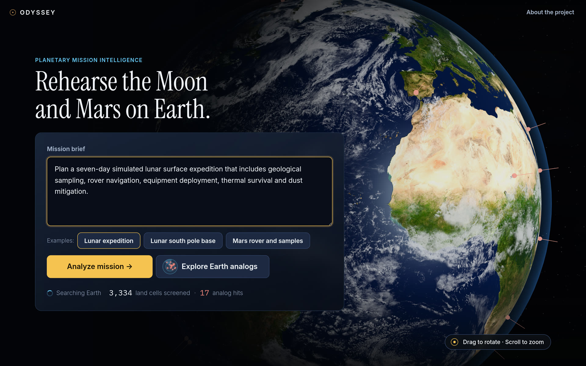
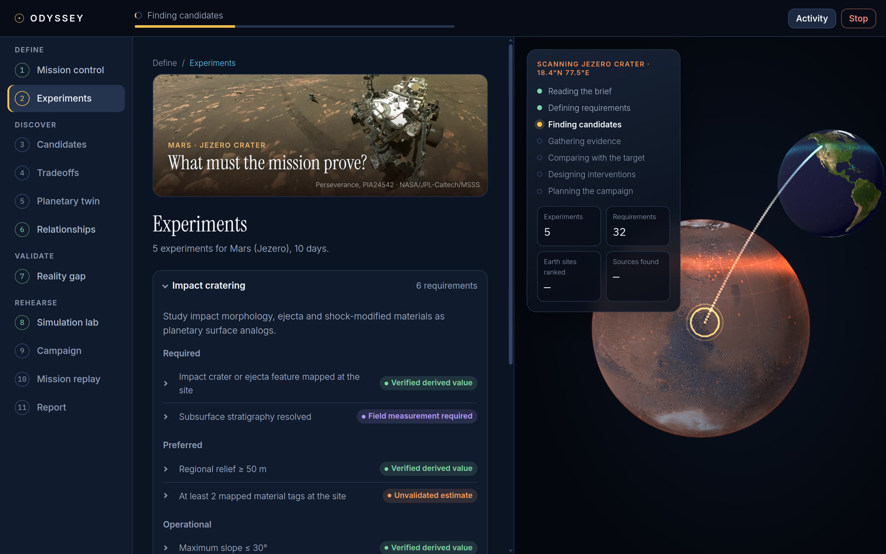
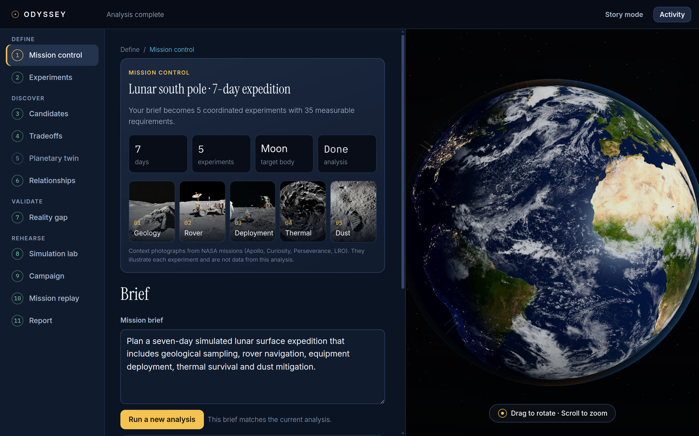
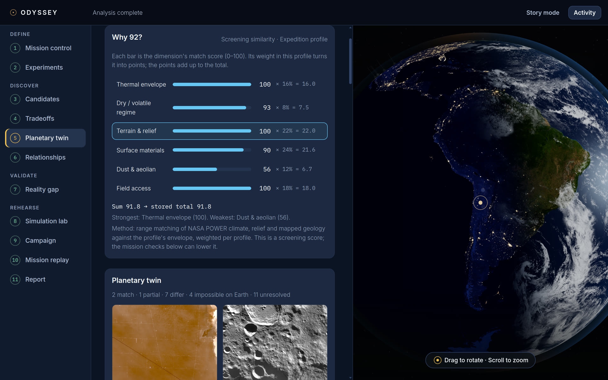
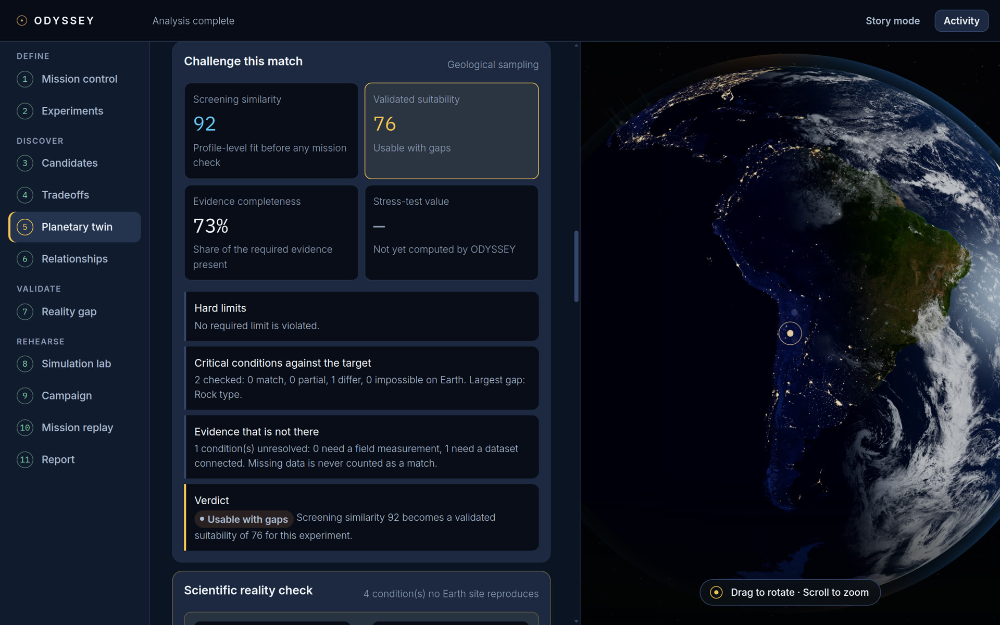
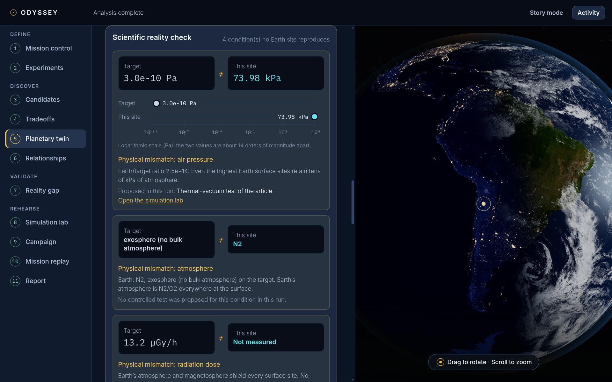
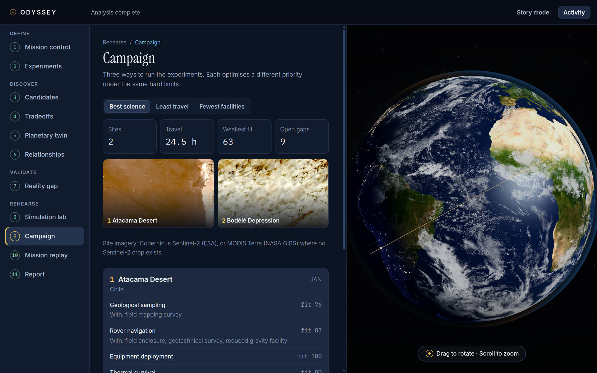
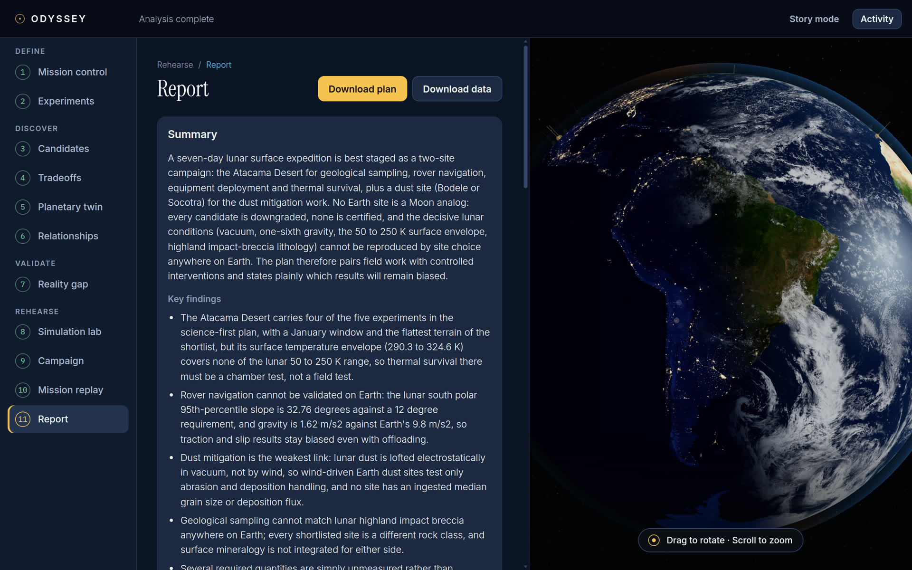

# ODYSSEY

**Plan Moon and Mars field tests on Earth, and see exactly where Earth falls short.**

ODYSSEY turns a plain-English mission brief ("a seven-day lunar expedition with geological sampling, rover navigation, equipment deployment, thermal survival and dust mitigation") into experiments, ranks the Earth sites that suit each experiment from open NASA and partner-agency data, compares every site with the lunar south pole or Mars's Jezero crater condition by condition, and names what no site can reproduce and how to test it instead.

Built by team **ناسا سبيس ابس جدا** for the NASA Space Apps Challenge 2026, challenge *Identify Earth Locations that Analog the Permanent Moon Base Locations and Mars*.

**Try it:** [live application](https://odyssey.qd.je/) · [example analysis](https://odyssey.qd.je/?run=65a483d3-9cd9-4369-b094-4df64a0c179a) · [NASA Space Apps project page](https://www.spaceappschallenge.org/2026/find-a-team/ns-sbys-bs-jd/?tab=project) · [30-second demo video](https://youtu.be/i5nh3yk-ONs) · [project description (PDF)](docs/submission/ODYSSEY_project_description.pdf)



---

## 1. Challenge (problem statement)

> **NASA Space Apps Challenge 2026:** *Identify Earth Locations that Analog the Permanent Moon Base Locations and Mars.*

Before people work on the Moon or Mars, they rehearse on Earth: in deserts, volcanic fields, impact craters and polar dry valleys. The hard part is choosing where.

* **No single site is a good analog for everything.** A site can be excellent for rover mobility and useless for testing equipment that must survive the cold. Mission teams still choose analog sites largely by reputation.
* **The comparison is rarely like-for-like.** Air temperature is compared with surface temperature, a 40 m slope with a 400 m one, a global average with a point measurement. The result looks quantitative but is not.
* **Some conditions do not exist anywhere on Earth.** Lunar gravity is 1.62 m/s² against Earth's 9.82. The Moon has no atmosphere and a 14-day night. No site choice can reproduce vacuum, radiation or one-sixth gravity.
* **Missing data is mistaken for a mismatch.** A dataset that exists but is not connected, a quantity that needs a field measurement, and a condition Earth physically cannot provide are three different problems with three different next steps. Most comparisons collapse them into "no data".
* **The evidence is scattered and hard to audit.** A planner needs to know which site suits which experiment, why, on what evidence, at what spatial and temporal support, and what to do about each remaining gap.

ODYSSEY answers that, and adds the step the challenge implies but does not spell out: **an honest, traceable list of where the analogy breaks.**

## 2. Solution idea

**Experiment first, not planet first.** A mission brief is decomposed into experiments; each experiment gets measurable requirements; sites are ranked per experiment and compared with the chosen target on 31 environmental dimensions. Every number is computed by deterministic, unit-aware code. The AI agent orchestrates the tools and writes narrative text; it never invents a value, score or decision.

The workspace follows the mission in four stages:

| Stage | Section | What it answers |
|---|---|---|
| **Define** | Mission control | Target, duration, experiments and requirements, with a photo per experiment |
| **Define** | Experiments | Every requirement with its evidence: verified, modelled, unvalidated estimate, field measurement required |
| **Discover** | Candidates | Sites ranked per experiment; hard limits reject, the best site opens automatically |
| **Discover** | Tradeoffs | Every site against every experiment; how validation reorders the ranking |
| **Discover** | Planetary twin | Why a site scores what it does; Earth and target side by side; *Challenge this match*; physics Earth cannot copy |
| **Discover** | Relationships | How measured Earth conditions move together across the analog sites |
| **Validate** | Reality gap | Conditions no site reproduces, and evidence that is missing, each with its cause and next step |
| **Rehearse** | Simulation lab | Controlled tests for what Earth cannot provide, as numbered proposed steps |
| **Rehearse** | Campaign | A multi-site field plan, optimised three ways |
| **Rehearse** | Mission replay | The analysis from brief to residual gaps, as a timeline |
| **Rehearse** | Report | Narrative, findings and exports (Markdown, JSON) |

*Story mode* walks through the stages for a presentation.

### The pipeline

```
Mission brief
     │
     ▼
1  Parse the brief            target, duration, experiment archetypes, verbatim evidence
2  Decompose experiments      measurable requirements with units, support and provenance
3  Rank Earth sites           hard filters, then per-experiment scores over 39 curated sites
4  Compare with the target    31 dimensions, only when quantity and support match
5  Validate evidence          verbatim source checks; missing data never becomes a match
6  Name every gap             integration needed / field measurement / physical mismatch
7  Propose interventions      thermal-vacuum chamber, gravity offload, CO₂ chamber
8  Optimise the campaign      best science / least travel / fewest facilities
9  Report and export          traceable plan, evidence graph, Markdown and JSON
```

### What makes it different

* **Experiment-first, not planet-first.** Sites are ranked per experiment, so a site can be recommended for dust work and rejected for geology.
* **Screening similarity is not suitability.** A site that screens at 92 drops to 76 once hard limits, critical conditions and missing evidence are checked. *Challenge this match* shows the difference.
* **Missing evidence is never a match, and never a mismatch.** Every gap says why it exists and what closes it: a dataset, a field test with a named protocol, or physics Earth cannot provide.
* **31 dimensions with explicit support.** Two values are compared only when quantity and support match. Air temperature is never compared with surface temperature; a 40 m slope never with a 400 m one.
* **A real tool-using agent with deterministic numbers.** 19 typed tools, budgets, preconditions, duplicate guard, checkpoints and resume. Search results stay *pending review* until the full source is retrieved and the quoted value is found in it.
* **It works without an AI key.** The same tools run in a fixed order (the deterministic planner), so the whole app works end to end offline.

### The demonstration

Brief: *"Plan a seven-day simulated lunar surface expedition that includes geological sampling, rover navigation, equipment deployment, thermal survival and dust mitigation."*

A saved run of this brief is in [`docs/demo/agent-run/`](docs/demo/agent-run/). It is **saved demonstration output** from 2026-11-14 (run `65a483d3`), not a live result.

* Five experiments, 35 requirements, 39 curated Earth sites, compared with the lunar south pole.
* **Geological sampling:** no curated site matches the south-pole lithology (highland impact breccia, Spudis et al. 2008), so every site is downgraded. Four sites are ruled out because even their barest 2 × 2 km area has under 5% bare ground (ESA WorldCover). ODYSSEY points to Manicouagan and Pingualuit, where Macrostrat maps anorthosite, as better geology analogs.
* **Thermal survival:** no Earth site reaches the lunar 50–250 K surface range, and air carries heat away where the Moon has vacuum. The plan uses a thermal-vacuum chamber, with a first-order pump-down model.
* **Evidence gaps, each with a next step:** bearing strength (dynamic cone penetrometer, ASTM D6951), SI thermal inertia (needle probe, ASTM D5334), grain size (sieve analysis) and rock exposure need field measurements. Dust deposition and mineralogy need datasets that exist but are not connected (MERRA-2 and EMIT require an Earthdata login).
* **Campaign:** Atacama Desert for four experiments plus the Bodélé Depression for dust, 24.5 hours of travel, with nine open conditions listed in the plan.

Step-by-step walkthrough: [`docs/demo/README.md`](docs/demo/README.md).

## 3. Technical architecture and algorithms



### Runtime stack

| Layer | Technology |
|---|---|
| Frontend | React 19, TypeScript, Three.js, react-globe.gl, Framer Motion, Vite |
| Backend | Node.js 22.13+ (`node:http`, `node:sqlite`), TypeScript via tsx, Server-Sent Events |
| Agent | OpenCode API, DeepSeek V4.1 Flash, OpenAI-compatible tool calling, reasoning off |
| Data pipelines | Python 3.12 (rasterio, pystac-client, numpy, scipy, scikit-learn, h3, Pillow) |
| Persistence | SQLite: runs, append-only events, source cache, reviewer feedback |
| Deployment | Single Docker image on Azure Container Apps; no dataset download needed |

### How the agent works

```
system prompt + brief
 └─▶ LLM turn ──tool calls──▶ executeTool() ──▶ typed state transition ──▶ compact JSON result
        ▲                         │  validation · preconditions · duplicate guard · budget · timeout · abort
        └─────────────────────────┘  every call written to the events table
 LLM stops / budget reached ──▶ deterministic completion of required steps ──▶ report
```

The LLM selects tools and writes the report narrative. The backend recomputes every matrix from typed state (`server/agent/engine.ts`); model text is never trusted for a number. Budgets: 64 tool calls (12 reserved for required completion), 36 LLM turns, 12 searches, 10 source fetches. State and transcript are checkpointed after every tool call, so a run can be cancelled and resumed.

### Algorithms and methods

| # | Algorithm / method | Where | What it does |
|---|---|---|---|
| 1 | **Constrained mission parsing** | `src/mission/decompose.ts`, `server/agent/tools.ts` | The LLM may only choose archetype IDs from a catalogue and must quote the brief verbatim; quoted fragments are checked, otherwise marked INFERRED. Target and duration are parsed with regexes. Without a key, keyword/regex matching does the same job. |
| 2 | **Requirement evaluation** | `src/mission/evaluate.ts`, `metrics.ts` | Each requirement is scored against a threshold with unit-aware comparison. The experiment score is a weight-normalised mean × a coverage factor `0.55 + 0.45 × coverage`, with caps: a missing required value caps the score at 84, a failed required value at 76, and coverage under 0.35 caps it at 35. |
| 3 | **Candidate ranking** | `server/science/candidates.ts` | Hard constraints first (a violated required limit, no suitable climate window, or required evidence coverage below the minimum rejects a site). Surviving sites get independent dimension ranks and a weighted aggregate: experiment suitability 0.35, terrain 0.15, evidence completeness 0.15, thermal 0.10, geology 0.10, operations 0.10, intervention feasibility 0.05 (weights renormalised over available dimensions). |
| 4 | **Screening versus suitability** | `server/science/candidates.ts`, `src/mission/evaluate.ts` | Screening similarity is the weighted aggregate. Validation then applies critical mismatches, evidence state and coverage. Example: Atacama 92 → 76; Kawah Ijen climbs 37 places for geology; no site is viable for the demo's geological sampling. |
| 5 | **Support-aware planetary comparison** | `server/science/profile.ts`, `mismatch.ts` | 31 environmental dimensions, each with a status (MEASURED, DERIVED, MODELED, PUBLISHED, PROXY, ESTIMATED, MISSING), a spatial and temporal support, unit and source. Values are compared only when quantity and support match. Each comparison carries `earthState`, `targetState`, `gapSide` and one outcome: evaluated, integration needed, field measurement, physical mismatch, investigation needed or not applicable. |
| 6 | **Verbatim evidence verification** | `server/evidence/retrieve.ts`, `verify.ts` | Allow-listed HTTPS fetch of HTML/PDF; an LLM proposes claims; a claim is kept only if the quote is verbatim, contains the number and names the right quantity. Unit-aware judgement marks SUPPORTED, CONTRADICTED or UNVERIFIED; contradictions are recorded. |
| 7 | **Evidence registry** | `src/mission/evidence.ts` | Every metric maps to quantity, unit, support, datasets investigated (*used*, *found not connected*, *not suitable*) and the next action. 17 evidence states collapse into six outcomes; "No open data" is not a state. |
| 8 | **Global analog discovery** | `scripts/global_discovery.py` | A deterministic H3 resolution-4 grid over global land: **81,575 cells** sampled with WorldClim 2.1, Natural Earth, Copernicus DEM and OurAirports, scored against lunar-base, Mars-landing and lunar-expedition profiles, then deduplicated and grouped into **80 regions** beyond the curated set; 70 are new relative to the 107 screened candidates and 39 curated sites. |
| 9 | **Campaign optimisation** | `src/campaign/engine.ts` | Exhaustive search over a pruned option set (top options per experiment), with hard limits on distinct sites, travel hours, start month and minimum fit. Three lexicographic priorities expose the trade-off: science-first maxes the weakest experiment fit, logistics-first minimises sites and travel, intervention-light minimises facility complexity. Rejected experiment-site pairs are never scheduled. |
| 10 | **Intervention physics** | `server/science/interventions.ts` | Ideal vacuum pump-down `t = (V·1000/S)·ln(p₀/p)`; radiative equilibrium `T = (αI·cosθ/(εσ) + T_shroud⁴)^0.25`; gravity offload `F = m(g₀ − g_target)`; projectile dust range `R = v²·sin2θ/g`. Outputs are labelled SIMULATED, PROPOSED CONTROLLED CONDITION or CONCEPT ONLY, and warn outside model validity. |
| 11 | **Temporal windows** | `src/temporal/engine.ts` | Monthly NASA POWER 2001–2020 normals are evaluated against each experiment's duration and limits, so a campaign can choose a month, not just a site. |
| 12 | **ML surrogate (context only)** | `scripts/train_model.py` | 15 features per site; RBF-SVR for lunar base and expedition, ExtraTrees (500 trees, depth 6) for Mars landing; 5-fold cross-validation. The score is shown as context and has **zero weight** in mission decisions. |
| 13 | **Deduplication and provenance** | `scripts/audit_generated_deduplication.py`, `src/data/*.json` | Generated regions are grouped, deduplicated and labelled with their data version. The catalogue overlap is reported rather than hidden. |

### Determinism and safety

* Every score, unit conversion, filter and optimisation runs in ordinary TypeScript shared by the browser and the server; there is no second implementation.
* The model never computes a number. A quantity-qualifier guard rejects a temperature difference read as a temperature, an envelope treated as support, and a dataset found by search counted as integrated.
* Prices, facility performance and field safety are not invented: they are reported as "not estimated", "capability class" and "requires field validation".

## 4. File directory of the code

```
ODYSSEY/
├── index.html                     Vite entry
├── package.json                   scripts, dependencies, Node ≥ 22.13
├── Dockerfile                     single-image production build
├── DATA_SOURCES.md                every dataset: identifier, unit, resolution, licence
├── THIRD_PARTY_NOTICES.md         code, data, imagery and font licences
│
├── src/                           React workspace + shared deterministic engines
│   ├── main.tsx, App.tsx          application entry
│   ├── workspace/                 11 sections: Mission, Experiments, Candidates, Tradeoffs,
│   │                              Twin, Relationships, Reality gap, Lab, Campaign,
│   │                              Replay, Report; story mode and phone layout
│   ├── mission/
│   │   ├── archetypes.ts          experiment recipes and thresholds
│   │   ├── decompose.ts           brief → experiments → requirements
│   │   ├── evaluate.ts            requirement and experiment scoring
│   │   ├── metrics.ts             unit-aware site metric extraction
│   │   └── evidence.ts            requirement-to-evidence registry
│   ├── campaign/engine.ts         multi-site, multi-window optimiser
│   ├── temporal/engine.ts         monthly climate windows
│   ├── interventions/             intervention catalogue and gap logic
│   ├── discovery/engine.ts        107-candidate screening engine
│   ├── data/                      committed derived datasets (39 sites, 107 candidates,
│   │                              80 generated regions, terrain, monthly climate)
│   └── components/                globe, Site Orbit, charts, shared UI
│
├── server/                        Node backend and agent
│   ├── index.ts                   REST + SSE API, static hosting, rate limit, auth
│   ├── agent/
│   │   ├── loop.ts                LLM tool loop, budgets, retries, completion
│   │   ├── tools.ts               19 typed tools with preconditions and guards
│   │   ├── state.ts               typed run state and checkpoints
│   │   ├── engine.ts              deterministic matrices from state
│   │   ├── investigate.ts         evidence-gap investigation
│   │   └── report.ts              report, evidence graph, Markdown export
│   ├── science/
│   │   ├── profile.ts             31-dimension Earth/target profiles
│   │   ├── mismatch.ts            physical and evidence mismatch classes
│   │   ├── candidates.ts          hard filters, rankings, aggregate
│   │   └── interventions.ts       pump-down, radiative, offload models
│   ├── evidence/                  allow-listed retrieval, verbatim verification,
│   │                              stdlib-only Python bridge to optional components
│   ├── llm/provider.ts            OpenCode / OpenAI-compatible provider
│   ├── store.ts                   SQLite runs, events, sources, feedback
│   └── tests/                     71 Node tests (science, evidence, verify, agent, HTTP)
│
├── scripts/                       reproducible data pipelines and release tooling
│   ├── fetch_sites.py             curated site climatology and imagery
│   ├── enrich.py                  geology, access, dust, model training data
│   ├── train_model.py             SVR / ExtraTrees surrogate, 5-fold CV
│   ├── discover_candidates.py     107-candidate screening set
│   ├── global_discovery.py        H3 global screen, 81,575 cells → 80 regions
│   ├── select_generated_enrichment.py
│   ├── enrich_generated_regions.py
│   ├── derive_planetary_reference.py   LOLA / MOLA same-baseline terrain
│   ├── derive_terrain_stats.py    slope, P95, roughness, relief
│   ├── fetch_surface_cover.py     ESA WorldCover bare-ground bound
│   ├── fetch_modis_lst.py         MODIS day/night land-surface temperature
│   └── test_*.py                  48 Python pipeline and algorithm tests
│
├── public/                        textures, site imagery, heightmaps, fonts
├── docs/
│   ├── architecture/              architecture and agent design
│   ├── science/                   methodology, audits, registry, model card
│   ├── screenshots/               the screenshots used here and in the PDF
│   ├── demo/agent-run/            saved demonstration run (Markdown + JSON + events)
│   ├── submission/                NASA Space Apps submission notes and this PDF
│   └── history/                   archived milestone and sprint reports
└── RELEASE_READINESS_REPORT.md    release checks, blockers and publication steps
```

**Where to start reading:** `server/agent/tools.ts` (the 19 tools), `src/mission/evaluate.ts` (scoring), `server/science/profile.ts` (the 31 dimensions), `docs/science/SCIENTIFIC_METHODOLOGY.md` (method and limitations).

## 5. Screenshots of the website

All screenshots are of the live application at [odyssey.qd.je](https://odyssey.qd.je/), run `65a483d3`.

| While the agent works: the target and Earth are scanned together | Mission control: the brief as a plan |
|---|---|
|  |  |
| **Candidates per experiment, scores coloured by value** | **Why a site scores what it does** |
|  |  |
| **Challenge this match: 92 screening becomes 76 suitability** | **Physics Earth cannot copy** |
|  |  |
| **Tradeoffs across experiments** | **Simulation lab** |
|  |  |
| **Campaign across sites and seasons** | **Report and mission replay** |
|  |  |

More: [planetary twin](docs/screenshots/v2-08-twin.jpg), [illumination](docs/screenshots/v2-11-illumination.jpg), [dust transport](docs/screenshots/v2-12-dust.jpg), [feature relationships](docs/screenshots/v2-13-relationships.jpg), [ranking evolution](docs/screenshots/v2-06-ranking.jpg), [reality gap](docs/screenshots/v2-14-reality-gap.jpg), [mission replay](docs/screenshots/v2-18-replay.jpg), [mobile](docs/screenshots/ux-10-mobile.png).

## 6. Conclusion and impact: test results and accuracy

### Conclusion

ODYSSEY turns a paragraph of mission intent into a traceable field plan. It does not pretend that Earth can be the Moon: it ranks what can be tested here, prices what must be tested in a chamber, and names what no amount of site selection can reproduce. The demonstration is deliberately unflattering: no curated site is recommended for the sample mission's geological sampling, and the strongest site drops from 92 to 76 once challenged. That is the point. A planner can act on a rejection that names its reason; a score out of 100 with no evidence behind it cannot be acted on at all.

### Impact

* **Mission and analog planners** can compare sites per experiment, pick a campaign and a season, and see the open conditions they will carry into the field.
* **Researchers and students** get a worked example of why a desert is or is not a Moon or Mars stand-in, with the source, support and limitation of every value.
* **The public and judges** can check any number back to a dataset, a published reference or a labelled assumption. A missing dataset is never silently converted into a pass or a fail.
* **The method transfers.** The requirement-to-evidence registry, the support-aware comparison and the three-way gap classification are reusable for any "is this environment like that one" question, not only Moon and Mars.

### Test results

All checks were run on 2026-11-14 in the working copy and in a fresh clone of the release candidate (`scripts/release-check.sh`), with no `.env`, no `external/` components and no database.

| Check | Command | Result |
|---|---|---|
| Node tests (working copy) | `npm test` | **71 pass, 0 fail, 3 skipped** (live tests need keys) |
| Node tests (fresh clone) | `npm test` | **68 pass, 0 fail, 6 skipped** (3 live + 3 optional components) |
| Python pipeline tests | `npm run test:python` | **48 pass** (Python 3.13) |
| Evidence regression suite | `server/tests/evidence.test.ts` | **25 tests**: missing dataset, budget exhaustion, failed search, not-integrated, no-coverage, incompatible units, side-specific gaps, upper-bound proxies, fabricated hits, verbatim-value pinning |
| TypeScript, app and server | `npm run build` | Pass |
| Production build | `npm run build` | Pass |
| Lint | `npm run lint` | Pass (4 warnings, all in legacy `?full`-mode files) |
| Secret scan | `npm run secrets:scan` / `secrets:history` | Pass (220 files, 7 bundle files, 276 historical blobs) |
| Link check | `python3 scripts/check_links.py` | Pass (0 broken local links); 22 of 30 external links answer, 8 publisher DOIs block bots and were confirmed through arXiv/NTRS/OpenAlex |
| Deterministic end-to-end run | fresh clone, no keys | **Pass, 2 s, 36 tool calls, 0 failures**; 8 evidence gaps explained; Markdown and JSON export |
| Live LLM run | run `65a483d3` | **Pass**, 52 tool calls, 12 searches, 8/8 gaps explained |
| Production UI | 390 × 844 viewport | Pass: renders the run, no console errors, no horizontal overflow |

**Total: 119 automated tests pass** (71 Node + 48 Python) with 0 failures in the working copy.

### Accuracy and validation results

| Measure | Result | What it means |
|---|---|---|
| Analog-ranking surrogate, lunar base | **R² 0.782**, MAE 3.36, Spearman 0.877, pairwise 0.850 | 5-fold CV over 39 sites; the model reproduces the transparent domain rubric, not independent ground truth |
| Analog-ranking surrogate, Mars landing | **R² 0.829**, MAE 3.80, Spearman 0.892, pairwise 0.866 | ExtraTrees, 500 trees, depth 6 |
| Analog-ranking surrogate, lunar expedition | **R² 0.787**, MAE 4.16, Spearman 0.896, pairwise 0.869 | RBF-SVR; used as context only, never in mission decisions |
| Evidence coverage after repair | **0 of 1,365** requirement-site cells labelled "No open data" (was 156) | Every cell now names one of: verified derived 340, modelled 429, unvalidated estimate 323, field measurement required 112, source found not integrated 39, not physically reproducible 117, ruled out 4, dataset not covering 1 |
| Gap explanation | **8 of 8** demonstration gaps explained | 4 field measurements, 1 target dataset to integrate, plus the comparison gaps: dust, mineralogy, lunar night temperature |
| Validation effect | **92 → 76** | Atacama's screening similarity becomes a validated suitability after critical conditions and missing evidence; Kawah Ijen climbs **37 places** in the geology ranking |
| Geology decision | **0 of 39 sites recommended** | Not a failure: the verified south-pole lithology matches no curated site, so every site is downgraded; the app points to Manicouagan and Pingualuit |
| Bare-ground bound coverage | **204 of 226** locations have ESA WorldCover data | WorldCover v200 overall map accuracy **76.7%**, not re-validated at these sites; used only as an upper bound, so it can reject but never confirm |
| Global discovery | **81,575 H3 land cells → 80 regions** | 70 are new relative to 107 screened candidates + 39 curated sites; the screen is independent of the curated coordinates |
| Source verification (demo) | **24 sources found, 3 read in full and verified** | A claim is kept only if the quoted value is found verbatim in the full text; a snippet's mangled "552" was pinned to the published 55 ± 2 |
| Demo rejection | **4 sites ruled out** by a validated upper bound | Lonar 2.1%, Wolfe Creek 0.2%, Undara 0.2%, Nullarbor 0.03% bare ground in the barest 2 × 2 km block |

### Honest limits

* A prototype: 39 curated sites, 107 screened candidates, 80 generated regions and two targets (lunar south pole, Jezero crater).
* 33 of 35 demonstration thresholds are recipe assumptions without a cited source; the interface labels them and invites editing. Two are audit proposals that need review.
* Climate is 2001–2020 reanalysis at ~50 km, not station data. MODIS surface temperature covers one warm-season window. Terrain is 40 m; rocks and rover-scale hazards are not resolved.
* Bearing strength, SI thermal inertia, grain size, mineralogy and fresh rock exposure are **not measured** at any site; ODYSSEY says so and names the field test and standard.
* Intervention outputs are setpoints and first-order models, not facility performance. Costs are not estimated.
* Field access and dust indices for the curated sites were assigned by hand and are labelled *unvalidated estimate*.
* Lunar references are regional or point values: thermal inertia is a global Diviner average, grain size comes from non-polar Apollo soils, darkness duration is for the best-lit Shackleton rim point.
* The ML surrogate is trained on 39 sites with a rubric-derived label and random 5-fold CV; it is a screening aid, not a validated global predictor.
* Earth cannot provide lunar or Martian gravity, vacuum, radiation or atmosphere at any site.

Scientific audits: [`docs/science/`](docs/science/). Release status and open issues: [`RELEASE_READINESS_REPORT.md`](RELEASE_READINESS_REPORT.md).

### Reproduce

```bash
npm ci
npm run lint
npm run build
npm test                 # 71 Node tests
npm run test:python      # 48 pipeline tests
npm run secrets:scan

npm run server           # API on http://127.0.0.1:8787
npm run dev              # UI on http://localhost:5173
```

Requirements: Node.js ≥ 22.13 (uses `node:sqlite`), npm, Python ≥ 3.12 for the data pipelines. No dataset download is needed: the derived data is committed in `src/data/` and `public/`; scripts in `scripts/` regenerate it from the original sources.

---

## Appendix: NASA data, AI use, licence and team

### NASA and partner data

From the challenge's Resources tab, ODYSSEY uses the **NASA Planetary Data System / LRO**: the LOLA south-polar DEM `LDEM_45S_400M` (PDS `LRO-L-LOLA-4-GDR-V1.0`) as the lunar terrain reference; **LRO Diviner** results (polar temperature range 50–250 K, regolith thermal inertia 55 ± 2) as published references; and **NASA Worldview/GIBS** imagery. Partner resources: **ESA Copernicus** DEM, Sentinel-2 and WorldCover, and **CSA RADARSAT-1**.

Other NASA data: NASA POWER (MERRA-2) 2001–2020 climatology, MODIS Aqua land-surface temperature (MYD11A1 v061), MGS MOLA, NSSDC planetary fact sheets, Blue Marble, Black Marble, and published Mars 2020 MEDA and LRO LOLA illumination results. Full identifiers, units, resolution, limitations and terms: [`DATA_SOURCES.md`](DATA_SOURCES.md).

### AI and SI use

* **In the product:** DeepSeek V4.1 Flash through the OpenCode API (`OPENCODE_MODEL` changes it) acts as the mission agent: it chooses tools, extracts claims from retrieved sources and writes the report narrative, with reasoning off. It never produces the numbers, scores or decisions; those come from tested code. Without a key, the deterministic planner runs the same tools.
* **During development:** Claude Code (Anthropic), Claude Opus 5.5, wrote and reviewed code, ran tests, researched and verified data sources and drafted documentation including this README and the PDF. Every source it cited was checked against the original document.
* **Demo video:** ElevenLabs text-to-speech (`eleven_v4`) and Music (`music_v2_5`) were used for the narration and instrumental track; ElevenLabs Scribe checked the final mix. The voice is synthetic and disclosed.
* **No AI-generated imagery.** The globe, terrain, site and context images come from NASA, ESA, USGS and Copernicus data; the starfield and grain textures are generated procedurally by code in this repository.

### Licence, credits and team

ODYSSEY's original code and documentation: **Apache License 2.0** ([`LICENSE`](LICENSE), [`NOTICE`](NOTICE)). Third-party code, fonts, imagery and data keep their own licences: [`THIRD_PARTY_NOTICES.md`](THIRD_PARTY_NOTICES.md) and [`DATA_SOURCES.md`](DATA_SOURCES.md). Contains modified Copernicus Sentinel and Copernicus DEM data. NASA data are used under NASA's open data policy; this project is not endorsed by NASA. No NASA logo or branding is used.

Team: **ناسا سبيس ابس جدا** ([NASA Space Apps project page](https://www.spaceappschallenge.org/2026/find-a-team/ns-sbys-bs-jd/?tab=project)).

Thanks to the authors of Earth-Location-Nasa (`mernaahany`) and the Reranker (`WA-on-test2`), and to the NASA, ESA, CSA, USGS, Macrostrat, WorldClim, Natural Earth and OurAirports teams whose open data make this possible. AI use is disclosed in [`docs/submission/NASA_SPACE_APPS_SUBMISSION.md`](docs/submission/NASA_SPACE_APPS_SUBMISSION.md). Challenge requirements and judging criteria are mapped in [`docs/submission/NASA_CHALLENGE_MAPPING.md`](docs/submission/NASA_CHALLENGE_MAPPING.md).
